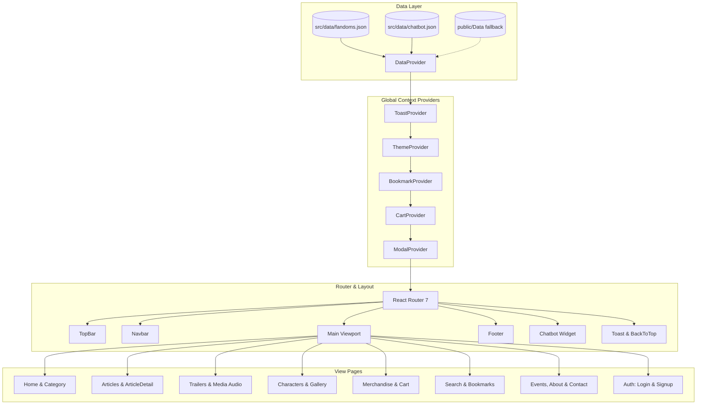
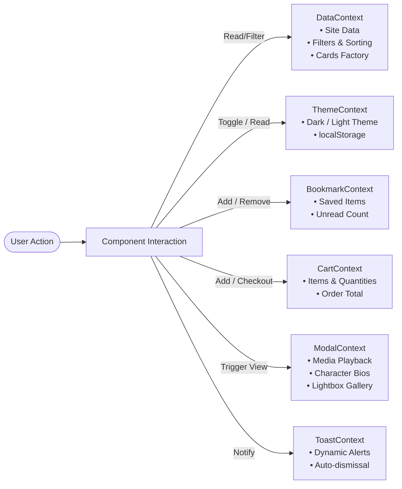

<div align="center">

# 🌌 FANDOMVERSE

### *The Ultimate Pop Culture, Anime, Gaming, Cinema & Fandom Hub*

[](https://react.dev/)
[](https://vitejs.dev/)
[](https://reactrouter.com/)
[](https://eslint.org/)
[](LICENSE)
[](#-production-build)
[](#-contributing)

<p align="center">
  <b>Explore universes. Stream trailers. Listen to OSTs. Collect merchandise. Chat with our fandom bot.</b>
  <br />
  A modern, responsive single-page web portal built for pop-culture enthusiasts across anime, gaming, cinema, TV shows, comics, manga, and K-Pop.
</p>

[✨ Key Features](#-key-features) •
[🏛️ Architecture](#-system-architecture) •
[📂 Project Structure](#-sorted-folder-structure) •
[🚀 Quick Start](#-getting-started) •
[🗺️ Route Directory](#-routing-guide) •
[🎨 Design System](#-design-system--theming)

---

</div>

## 📖 Overview

**FandomVerse** is an entertainment portal that brings together passionate fan communities into a single destination. Engineered with **React 19**, **Vite 8**, and a robust **Context API state management architecture**, FandomVerse delivers lightning-fast performance, deep interactivity, and an obsidian & gold aesthetic with full dark/light mode support.

Whether discovering upcoming comic conventions, queuing anime OSTs, reading in-depth franchise lore, bookmarking favorite character profiles, or exploring exclusive merchandise, FandomVerse offers a rich, unified user experience.

---

## ✨ Key Features

<table>
  <tr>
    <td width="50%">
      <h3>🪐 7 Fandom Universes</h3>
      Dedicated hubs covering <b>Anime</b>, <b>Gaming</b>, <b>Movies</b>, <b>TV Shows</b>, <b>K-Pop</b>, <b>Comics</b>, and <b>Manga</b> with category-specific banners, curated tags, and tailored color accents.
    </td>
    <td width="50%">
      <h3>🤖 AI-Powered Fandom Chatbot</h3>
      Interactive in-app assistant powered by intent classification datasets (<code>chatbot.json</code>). Features quick suggestions, live search linking, sound cues, and unread notification badges.
    </td>
  </tr>
  <tr>
    <td width="50%">
      <h3>🎬 Multi-Media & Trailer Streamer</h3>
      Integrated video cinema viewer for HD trailers, accompanied by an interactive audio jukebox with playlist playback for theme songs and original soundtracks.
    </td>
    <td width="50%">
      <h3>🛡️ Character Encyclopedia</h3>
      Extensive character rosters with biographies, signature powers, franchise connections, and deep-dive modals filterable by universe.
    </td>
  </tr>
  <tr>
    <td width="50%">
      <h3>🛍️ Merchandise Emporium & Cart</h3>
      Browse official apparel, collectibles, and accessories with a fully reactive shopping cart (`CartContext`), currency formatting (`Rs.`), and instant checkout modal.
    </td>
    <td width="50%">
      <h3>📑 Local Bookmarks & Favorites</h3>
      Persistent bookmarking system stored directly in `localStorage` (`BookmarkContext`), allowing users to save articles, trailers, and media for offline recall.
    </td>
  </tr>
  <tr>
    <td width="50%">
      <h3>📅 Events & Premiere Countdown</h3>
      Real-time release radar tracking conventions, game releases, and movie premieres with dynamic upcoming date validation (`isUpcoming`).
    </td>
    <td width="50%">
      <h3>🌓 Obsidian & Gold Theme Switcher</h3>
      Toggle seamlessly between a luxury Dark (Obsidian + Gold) and clean Light palette with CSS custom properties and instant persistence (`ThemeContext`).
    </td>
  </tr>
</table>

---

## 🏛️ System Architecture

FandomVerse uses a layered, unidirectional state architecture powered by React 19 Context Providers wrapped around React Router 7.



### Context Pipeline Breakdown



---

## 📂 Sorted Folder Structure

The project has been organized following modern React and Vite production conventions:

```
fandomverse/
├── 📁 dist/                          # Production-ready compiled build
│   ├── 📁 assets/                    # Minified & fingerprint-hashed CSS & JS bundles
│   ├── 📁 Audio/                     # Static MP3 audio tracks
│   ├── 📁 Data/                      # Fallback JSON datasets
│   ├── 📁 Images/                    # Optimized SVGs, posters & merchandise art
│   ├── favicon.svg                   # Vector site icon
│   └── index.html                    # Minified production HTML
│
├── 📁 public/                        # Static assets served at root
│   ├── 📁 Audio/                     # Category OSTs and theme audio files
│   │   ├── anime-1.mp3, anime-2.mp3
│   │   ├── gaming-1.mp3, gaming-2.mp3
│   │   ├── movies-1.mp3, movies-2.mp3
│   │   └── ...
│   ├── 📁 Data/                      # Synchronized JSON datasets for client fetch
│   │   ├── chatbot.json              # Chatbot intents, queries & responses
│   │   └── fandoms.json              # Universes, characters, articles & events
│   ├── 📁 Images/                    # Public raster & vector images
│   │   ├── 📁 merch/                 # Vector merchandise graphics (hoodies, mugs, caps)
│   │   ├── banner 1.jfif, banner 2.jfif
│   │   ├── category.png
│   │   └── placeholder.svg
│   ├── favicon.svg                   # Brand vector favicon
│   └── icons.svg                     # Reusable SVG sprite icons
│
├── 📁 src/                           # Application source code
│   ├── 📁 assets/                    # Local imports & asset pipeline (.gitkeep)
│   ├── 📁 components/                # Reusable UI & Layout Components
│   │   ├── Card.jsx                  # Polymorphic card renderer (article, video, audio, merch)
│   │   ├── Chatbot.jsx               # Interactive AI chat assistant with intents
│   │   ├── CommonUI.jsx              # BackToTop, loader, and shared atoms
│   │   ├── Footer.jsx                # Global responsive footer with links & newsletter
│   │   ├── Navbar.jsx                # Responsive navbar with search & dropdowns
│   │   └── TopBar.jsx                # Top alert bar with theme toggle & social links
│   │
│   ├── 📁 context/                   # Global State Providers (React Context)
│   │   ├── BookmarkContext.jsx       # Bookmark storage & persistence
│   │   ├── CartContext.jsx           # Shopping cart state & checkout logic
│   │   ├── DataContext.jsx           # Main data orchestrator, filters & card builders
│   │   ├── ModalContext.jsx          # Unified modal manager (video, audio, merch, gallery)
│   │   ├── ThemeContext.jsx          # Dark / Light theme engine
│   │   └── ToastContext.jsx          # Notification toast dispatcher
│   │
│   ├── 📁 data/                      # Bundled datasets imported synchronously
│   │   ├── chatbot.json              # Conversational intents & quick suggestions
│   │   └── fandoms.json              # Complete catalog of categories, lore & media
│   │
│   ├── 📁 pages/                     # Routed Page Views
│   │   ├── About.jsx                 # Platform story, mission & statistics
│   │   ├── ArticleDetail.jsx         # Full article reader with related posts
│   │   ├── Articles.jsx              # Filterable article catalog & archives
│   │   ├── Bookmarks.jsx             # User saved articles and media library
│   │   ├── Category.jsx              # Dedicated universe hub (Anime, Gaming, etc.)
│   │   ├── Characters.jsx            # Character encyclopedia & roster
│   │   ├── Contact.jsx               # Contact form, FAQ & support channels
│   │   ├── Events.jsx                # Conventions & premiere countdown calendar
│   │   ├── Gallery.jsx               # High-definition fandom image gallery
│   │   ├── Home.jsx                  # Main landing page & featured showcases
│   │   ├── Login.jsx                 # User sign-in interface
│   │   ├── Media.jsx                 # Audio & soundtrack streaming studio
│   │   ├── Merchandise.jsx           # E-commerce store & merchandise catalog
│   │   ├── Search.jsx                # Universal multi-collection search engine
│   │   ├── Signup.jsx                # Member registration interface
│   │   └── Trailers.jsx              # Video cinema & movie/game trailers
│   │
│   ├── App.jsx                       # Root application component & route tree
│   ├── index.css                     # Master design system & CSS variables (2600+ lines)
│   └── main.jsx                      # React 19 entry point and DOM root mount
│
├── .gitignore                        # Git exclusion rules
├── eslint.config.js                  # ESLint 10 flat configuration with React hooks rules
├── index.html                        # HTML5 document template
├── package.json                      # Project metadata, dependencies & scripts
└── vite.config.js                    # Vite bundler configuration
```

---

## 🛠️ Tech Stack & Dependencies

| Category | Technology | Version | Purpose |
| :--- | :--- | :--- | :--- |
| **Core Framework** | [React](https://react.dev/) | `^19.2.8` | High-performance declarative component UI |
| **DOM Renderer** | [React DOM](https://react.dev/) | `^19.2.8` | React DOM binding |
| **Routing** | [React Router DOM](https://reactrouter.com/) | `^7.18.4` | Client-side routing with query param sync |
| **Build Tool** | [Vite](https://vitejs.dev/) | `^8.3.0` | Ultra-fast HMR and optimized Rollup production bundler |
| **Plugin** | [@vitejs/plugin-react](https://github.com/vitejs/vite-plugin-react) | `^6.1.1` | Fast Refresh and JSX transformation |
| **Linter** | [ESLint](https://eslint.org/) | `^10.10.0` | Code quality and React 19 hooks compliance |
| **Typography** | [Poppins](https://fonts.google.com/specimen/Poppins) | Google Fonts | Modern, clean geometric sans-serif typeface |
| **Styling** | Native CSS3 | Custom System | CSS Custom Properties (Variables), Flexbox, CSS Grid |

---

## 🚀 Getting Started

### Prerequisites

Ensure you have the following installed:
- [Node.js](https://nodejs.org/) (Version **18.0.0** or higher recommended)
- [npm](https://www.npmjs.com/) (Version **9.0.0** or higher)

### 1. Installation

Clone or download this repository, then install project dependencies:

```bash
# Navigate to project directory
cd fandomverse

# Install dependencies
npm install
```

### 2. Development Server

Start the local Vite development server with Hot Module Replacement (HMR):

```bash
npm run dev
```

Open your browser and navigate to:
```
http://localhost:5173
```

### 3. Production Build

To compile and bundle the project for production deployment:

```bash
npm run build
```

The optimized static assets will be output to the `dist/` folder, ready for zero-configuration deployment to platforms like **Vercel**, **Netlify**, **GitHub Pages**, or **Cloudflare Pages**.

### 4. Production Preview

To locally test and preview the production build:

```bash
npm run preview
```

### 5. Linting

Verify code quality and adherence to React standards:

```bash
npm run lint
```

---

## 🗺️ Routing Guide

FandomVerse supports both modern clean URLs and legacy `.html` path aliases:

| Route Path | View Component | Description |
| :--- | :--- | :--- |
| `/` | `Home.jsx` | Landing hero, featured universes, trending cards & latest updates |
| `/category` | `Category.jsx` | Universe-specific dashboard (`?c=anime`, `?c=gaming`, etc.) |
| `/articles` | `Articles.jsx` | Complete news feed, reviews, lore write-ups, and filter pills |
| `/article` | `ArticleDetail.jsx` | Deep-dive article view (`?id=article-id`) with related reads |
| `/trailers` | `Trailers.jsx` | Full-screen video theater with modal video playback |
| `/media` | `Media.jsx` | Audio listening station with custom controls and category playlists |
| `/characters` | `Characters.jsx` | Roster encyclopedia with power listings and biography modals |
| `/merchandise` | `Merchandise.jsx` | Merch catalog with shopping cart drawer and checkout flow |
| `/events` | `Events.jsx` | Conventions, watch parties, and countdown trackers |
| `/gallery` | `Gallery.jsx` | Interactive lightbox image gallery |
| `/search` | `Search.jsx` | Cross-collection global search with live query parameter sync |
| `/bookmarks` | `Bookmarks.jsx` | User's saved library stored locally across sessions |
| `/about` | `About.jsx` | Mission statement, team intro, and platform highlights |
| `/contact` | `Contact.jsx` | Contact submission form, location info, and FAQ accordion |
| `/login` | `Login.jsx` | Authentication sign-in portal |
| `/signup` | `Signup.jsx` | New member registration portal |
| `*` | `Home.jsx` | Catch-all fallback returning to the Home page |

---

## 🎨 Design System & Theming

The user interface uses a custom CSS token design system in `src/index.css`. The primary visual theme is **Black & Gold** with an accessible light mode alternative.

### Core Color Palette

| Token | Hex Value | Preview | Usage |
| :--- | :--- | :--- | :--- |
| `--gold` | `#d4af37` | `■` | Primary accent, CTA borders, badges, brand highlights |
| `--gold-light` | `#f3d77a` | `■` | Hover states, glowing effects, high-contrast labels |
| `--bg` (Dark) | `#0d0d0f` | `■` | Primary obsidian background |
| `--bg-2` (Dark) | `#151518` | `■` | Secondary elevated surface |
| `--card` (Dark) | `#1b1b20` | `■` | Card and container backgrounds |
| `--border` (Dark) | `#2e2e36` | `■` | Subtle card borders and dividers |
| `--bg` (Light) | `#f6f4ee` | `■` | Light mode primary cream background |
| `--card` (Light) | `#ffffff` | `■` | Light mode card surface |
| `--danger` | `#e63946` | `■` | Error messages, live badges, destructive actions |
| `--success` | `#2a9d8f` | `■` | Confirmations, in-stock merch, success notifications |

### Typography & Layout
- **Font Family**: `'Poppins', Arial, sans-serif`
- **Border Radius**: `14px` (`--radius`)
- **Box Shadows**: Glassmorphism and layered glow effects (`0 10px 30px rgba(0, 0, 0, 0.45)`)
- **Transitions**: Smooth 0.3s transitions across color, theme, and transform properties

---

## 🤝 Contributing

Contributions make the open-source community an amazing place to learn, inspire, and create. Any contributions to **FandomVerse** are appreciated!

1. **Fork the Project**
2. **Create your Feature Branch**:
   ```bash
   git checkout -b feature/EpicNewFeature
   ```
3. **Commit your Changes**:
   ```bash
   git commit -m "Add: Interactive anime soundtrack visualizer"
   ```
4. **Push to the Branch**:
   ```bash
   git push origin feature/EpicNewFeature
   ```
5. **Open a Pull Request**

---

## 📄 License

Distributed under the **MIT License**. See `LICENSE` for more information.

---

<div align="center">
  <sub>Built with ❤️ for fandom communities worldwide by <a href="https://github.com/Hammad">Hammad</a>.</sub>
</div>
